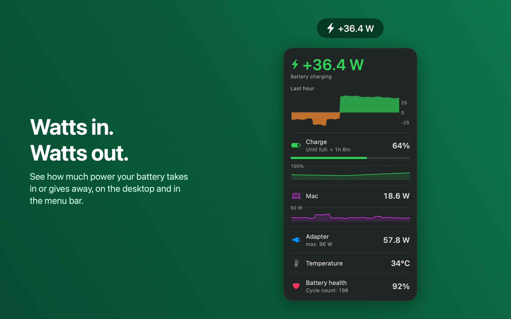
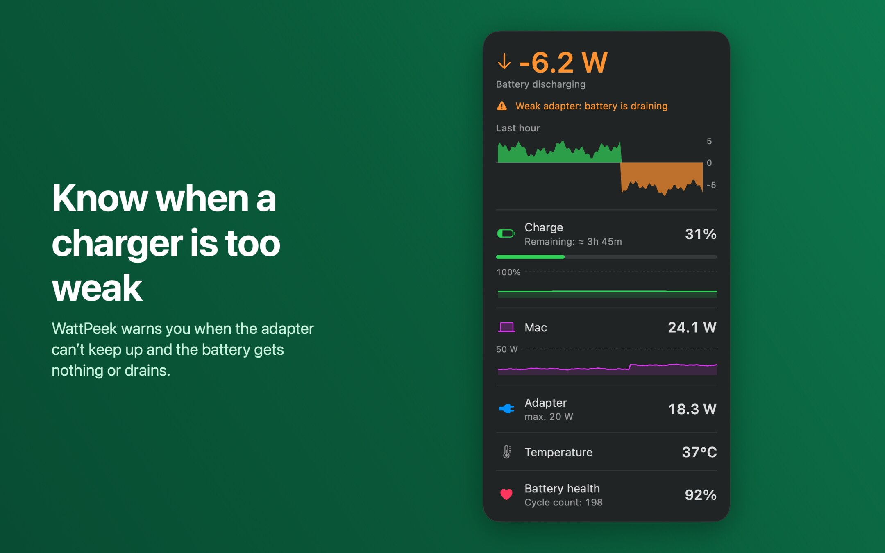
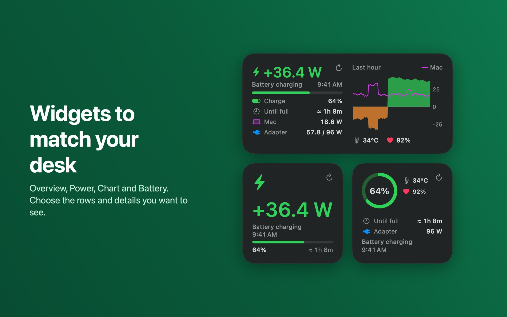
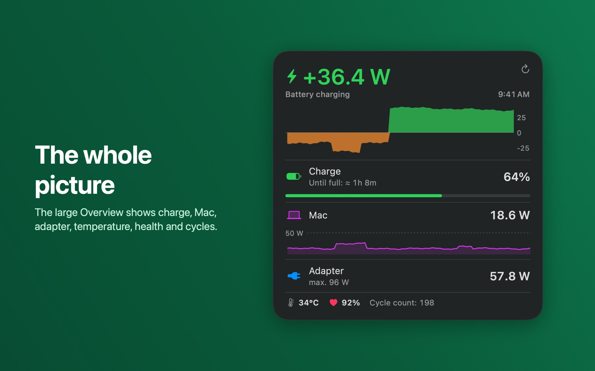
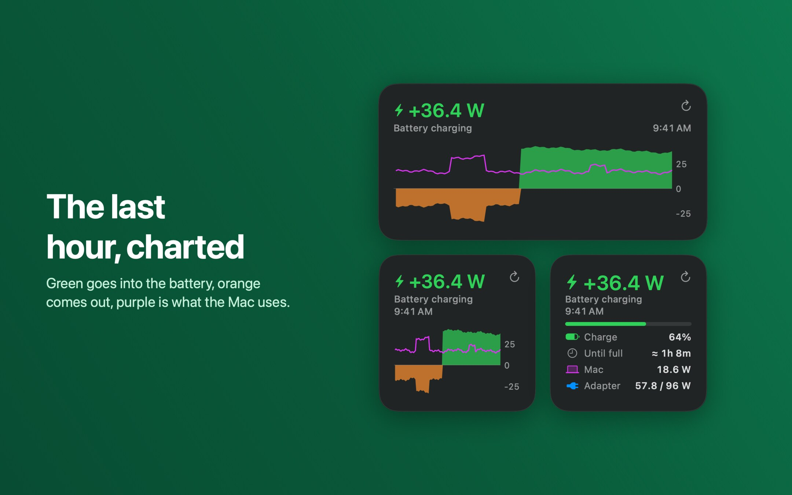
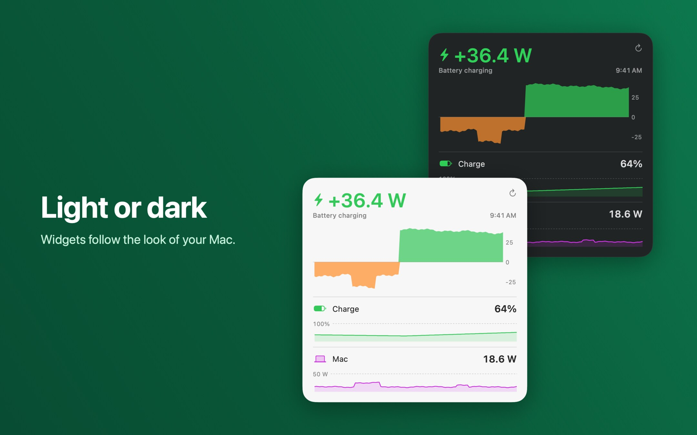
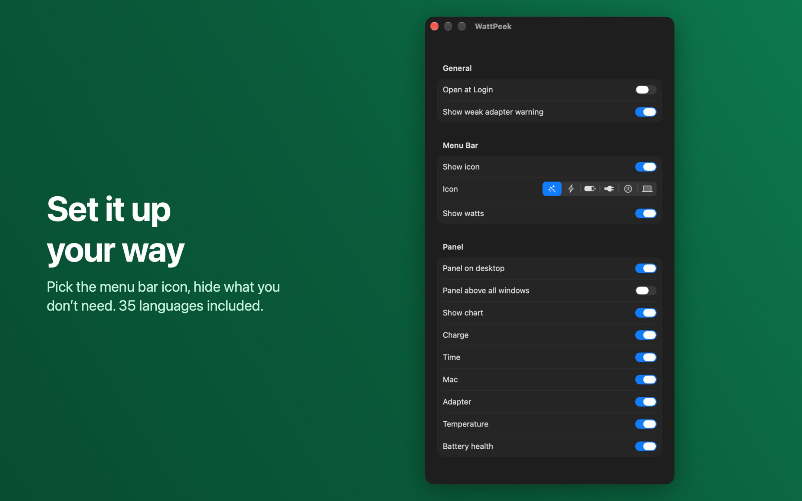

# WattPeek

See how many watts go into your MacBook’s battery, how many come out, and whether your charger keeps up. Free and open source.



- **Menu bar and desktop panel**, updated every 2 seconds: battery power, what the Mac uses, what the adapter delivers next to its rating, charge, estimated time, battery temperature, health and cycle count
- **Charts of the last hour**: battery, charge and Mac
- **Double-click the menu bar icon** to show or hide the panel
- **Weak adapter warning** when the charger is near its limit and the battery still drains or barely charges
- **Four widgets**: Overview and Chart in three sizes, Power and Battery in small. Each can be adjusted, and the refresh button updates it at once; otherwise macOS decides how often widgets refresh
- **35 languages**, following your Mac. The translations have not been reviewed by native speakers; corrections are welcome
- No network connections, no account, no data collection

| | |
|---|---|
|  |  |
|  |  |
|  |  |

The screenshots show the app’s own interface with sample data.

## Requirements

A MacBook with Apple silicon and macOS 14 or later. Tested on one machine: a MacBook Pro with M4 Max on macOS 27.3. Intel is not supported.

## Install

1. Download `WattPeek.zip` from [the latest release](https://github.com/havryshkevych/WattPeek/releases/latest) and unzip it.
2. Move `WattPeek.app` to Applications and open it.
3. The app is **not notarized by Apple**, so macOS will block the first launch. Open **System Settings → Privacy & Security**, scroll down and choose **Open Anyway**. If you prefer not to trust a binary, build it yourself (below).

There is no Dock icon: look in the menu bar. Settings are in its menu, or open the app again.

To add a widget, Control-click the desktop, choose **Edit Widgets** and find WattPeek.

## Build

Needs Xcode and [XcodeGen](https://github.com/yonaskolb/XcodeGen) (`brew install xcodegen`). No Apple developer account is needed.

```sh
./build.sh
```

The script runs the self-checks, builds `dist/WattPeek.zip`, then **replaces** `~/Applications/WattPeek.app` and opens it. The self-checks need a MacBook.

## How it works

Readings come from the SMC: battery current and voltage (`B0AC`, `B0AV`), adapter power (`PDTR`), system power (`PSTR`) and battery temperature (`TB0T`). Battery health is the Maximum Capacity reported by `system_profiler`, read once a day. If the SMC is unavailable, WattPeek falls back to the IORegistry, which updates about once a minute and has no temperature. These sources are not documented by Apple and may change.

The app writes a snapshot with up to one hour of history to `~/Library/Application Support/WattPeek`, and the sandboxed widget reads it.

Times are estimates from the current power. Charging usually slows down near full.

## License

[MIT](LICENSE)
